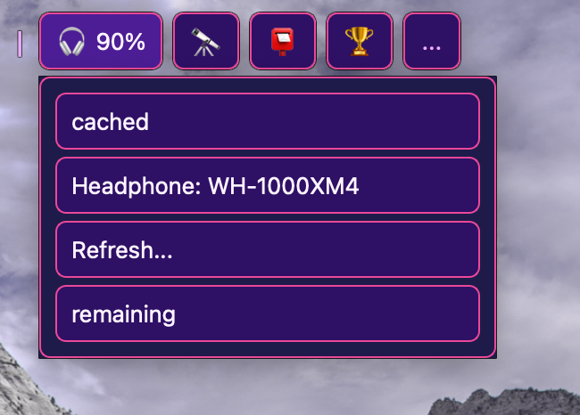

# Topbar Runner

Topbar Runner is a floating, cross-platform topbar for xbar-style plugins. It runs Python or shell scripts on a schedule and shows their output as clickable chips and menus.



## Quick start

Requires Python 3.11–3.14 and [Poetry](https://python-poetry.org/).

```bash
poetry install
poetry run topbar-runner
```

Choose a plugin directory on first launch. To try the included example without opening the UI:

```bash
poetry run topbar-runner --console --plugin-dir examples/plugins
```

Name plugins like `weather.5m.py` or `status.1h.sh` to set their refresh interval.

See [Manual](MANUAL.md) for plugin output, actions, settings, and keybindings; [Features](Features.md) for supported behavior; and [Packaging](packaging/README.md) for portable builds.
